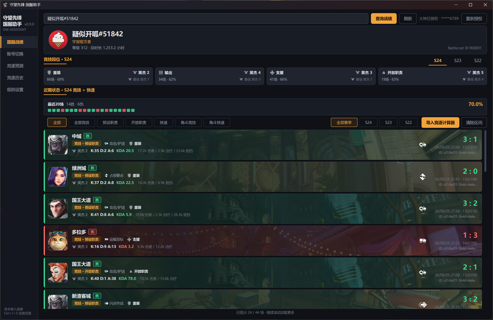
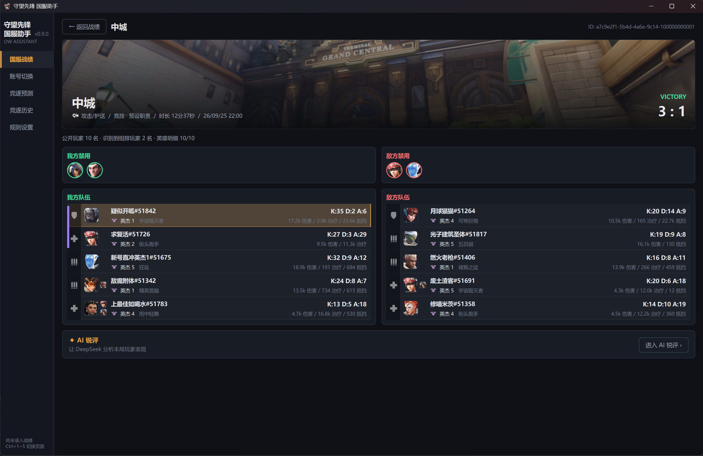
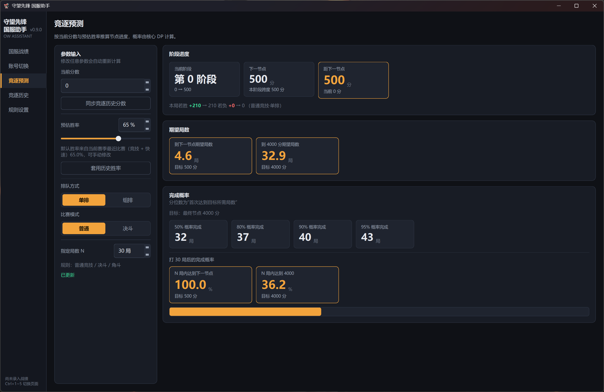
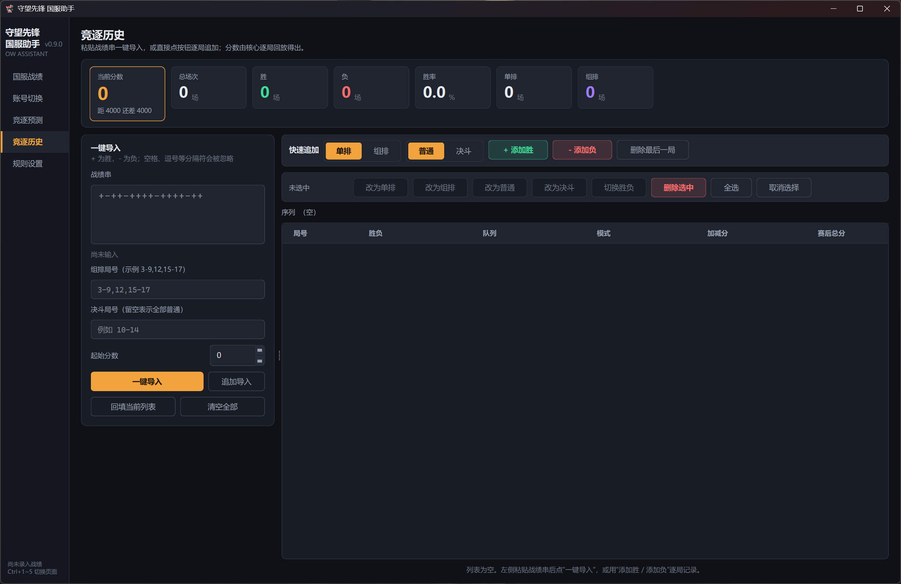
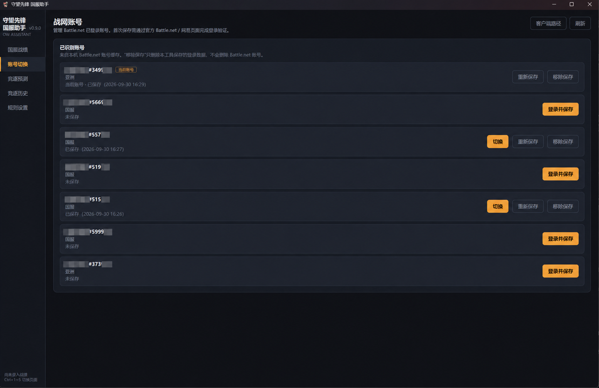
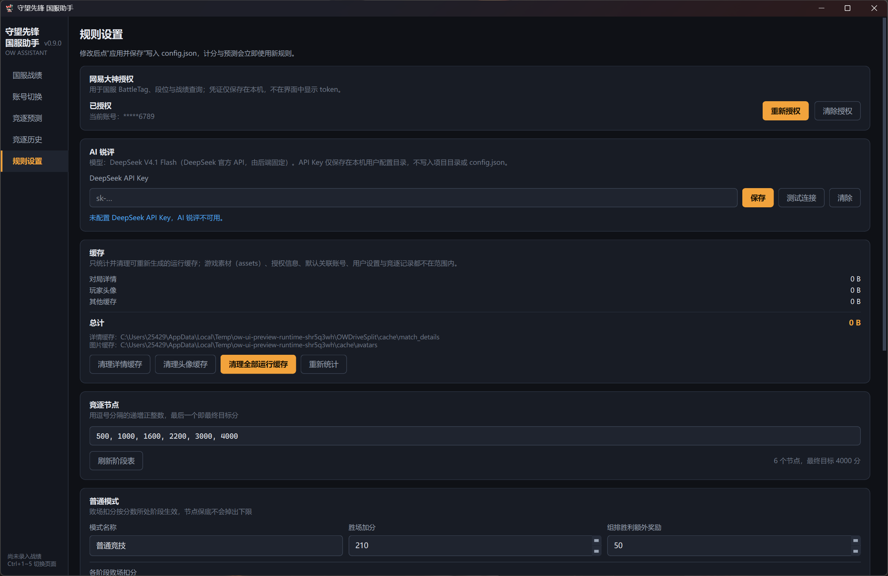
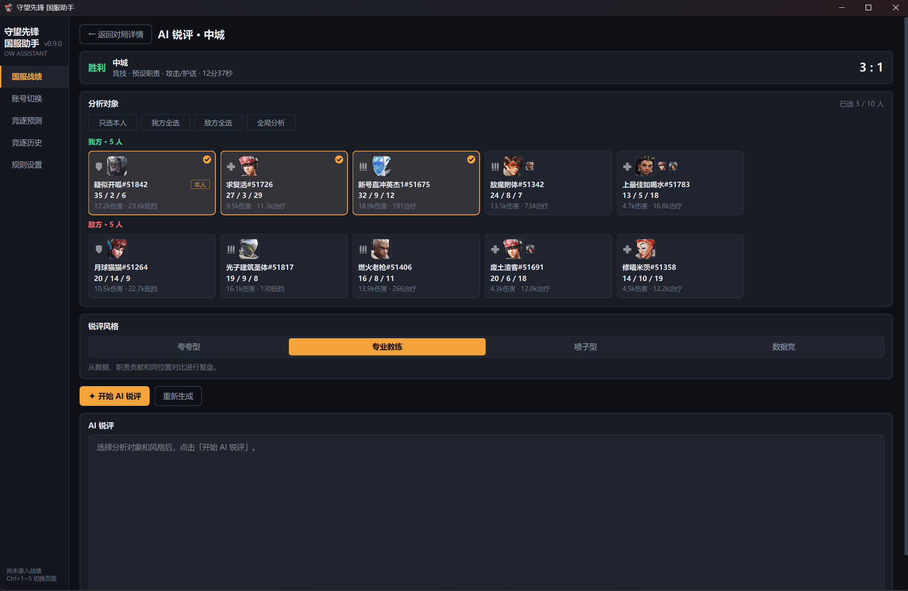

# 守望先锋 国服助手（OW Assistant）

> **当前版本：v0.9.0 Beta / 测试版**
>
> 本项目仍处于测试阶段，功能、界面、数据结构和本地配置格式都可能继续调整。网易大神或 Battle.net 客户端更新后，部分功能也可能暂时失效。
>
> **AI 锐评属于实验性功能。** AI 输出可能存在误判、遗漏或事实错误，仅供娱乐和复盘参考，不应视为对玩家水平、操作或决策的客观结论。

一个面向《守望先锋》国服玩家的 Windows 桌面工具，使用 PySide6 开发。目前整合了国服战绩查询、单局详情、竞逐预测/历史、Battle.net 账号切换以及实验性的 AI 锐评等功能。

本项目为非官方第三方项目，与 Blizzard Entertainment、网易、网易大神、Battle.net 或 DeepSeek 无隶属、授权、赞助或背书关系。

## 功能概览

- **国服战绩**：通过网易大神授权读取关联账号信息、段位与近期对局，支持动态赛季、预设职责 / 开放职责等数据展示。
- **对局详情**：查看地图、模式、双方玩家、职责、英雄、主要统计数据等详细信息，并使用本地缓存减少重复请求。
- **竞逐预测**：根据当前分数、胜率和规则参数推算阶段目标、完成概率与预计进度；近期胜率可以自动带入预测页。
- **竞逐历史**：保存和回放竞逐记录，支持从战绩列表选择起止对局并按区间导入，而不是只能整赛季导入。
- **账号切换**：保存本机 Battle.net 账号登录状态并在已保存账号之间切换；不会读取或保存 Battle.net / 网易明文密码。
- **规则设置与缓存管理**：配置竞逐节点、加减分规则、大神授权及本地缓存。
- **AI 锐评（实验性）**：基于单局详情调用 DeepSeek API，对本人、指定玩家或整局进行流式分析，支持多种输出风格。

## 界面预览

`screenshoot/` 文件夹仅用于存放 GitHub / README 的 UI 展示截图，不参与程序运行，也不会进入正式发布包。README 直接引用这些文件，因此除非同步修改文档，否则请不要随意更改截图文件名。

<table>
  <tr>
    <td align="center"><br><b>国服战绩</b></td>
    <td align="center"><br><b>对局详情</b></td>
  </tr>
  <tr>
    <td align="center"><br><b>竞逐预测</b></td>
    <td align="center"><br><b>竞逐历史</b></td>
  </tr>
  <tr>
    <td align="center"><br><b>账号切换</b></td>
    <td align="center"><br><b>规则设置</b></td>
  </tr>
  <tr>
    <td align="center" colspan="2"><br><b>AI 锐评（实验性）</b></td>
  </tr>
</table>

## 运行环境

当前主要开发 / 测试环境：

- Windows 10 / 11 x64
- Python 3.14
- PySide6
- `httpx`
- `mini-racer`
- Pillow

账号切换功能依赖本机 Battle.net 桌面客户端，因此目前主要面向 Windows 使用。
## Release 版本运行

如果只是使用本程序，不需要配置 Python 环境。请前往仓库右侧的 **Releases** 页面下载最新版本。

目前提供两种 Windows 发行形式：

### 1. 安装版

文件名类似：

```text
OWAssistant_Setup_v0.9.0.exe
```

直接运行安装程序即可。

安装版特点：

- 默认安装到当前用户目录，不需要管理员权限；
- 创建开始菜单快捷方式；
- 安装时可选择创建桌面快捷方式；
- 支持通过 Windows 正常卸载；
- 已包含程序运行所需组件，无需另外安装 Python。

适合希望像普通 Windows 软件一样安装和使用的用户。

### 2. 免安装版

文件名类似：

```text
OWAssistant_Portable_v0.9.0.zip
```

下载后需要**完整解压**，目录大致如下：

```text
OWAssistant_Portable_v0.9.0/
├─ OWAssistant.exe
└─ _internal/
```

双击 `OWAssistant.exe` 即可运行。

请不要删除或移动 `_internal` 文件夹中的内容，也不要直接在 ZIP 压缩包内运行程序。

免安装版不会写入传统的软件安装目录，适合临时使用、移动存放或不希望执行安装程序的用户。

> **当前项目仍处于测试阶段**
>
> 部分功能可能存在 Bug、兼容性问题或接口失效情况。遇到问题时可以在 GitHub Issues 中反馈，并尽量附上程序版本、问题描述和相关日志。
>
> **AI 锐评目前属于实验性功能。**
> 该功能需要用户自行配置 DeepSeek API，模型生成的评价可能存在遗漏、误判或不准确内容，仅供娱乐和战绩分析参考，不应视为对玩家水平的客观判定。

### Windows 安全提示

当前发布版本暂未使用商业代码签名证书，因此 Windows Defender / SmartScreen 可能显示“未知发布者”等提示。

建议仅从本项目官方 **GitHub Releases** 页面下载安装包，并可使用 Release 中提供的 `SHA256SUMS.txt` 校验下载文件完整性。

## 从源码运行

建议使用 PowerShell 7，在项目根目录执行：

```powershell
py -3.14 -m venv .venv
.\.venv\Scripts\python.exe -m pip install -r requirements.txt
.\.venv\Scripts\python.exe scripts\download_ow_assets.py
.\.venv\Scripts\python.exe main.py
```

第一次运行前需要准备本地游戏静态素材。也可以直接运行项目根目录的：

```text
00_下载OW素材.cmd
```

静态素材准备完成后，正常启动 UI 时不会再为了这些素材重复联网下载。

## AI 锐评：实验性功能说明

AI 锐评当前通过用户自行配置的 **DeepSeek API** 工作。该功能仍处于实验阶段，请注意：

- AI 只基于程序能够取得并整理的数据进行分析，无法完整理解实际对局中的站位、语音、临场决策和未被记录的信息。
- 模型可能产生错误推断、遗漏甚至幻觉；不同时间、不同模型版本下的输出也可能变化。
- 锐评内容仅供娱乐、复盘和辅助参考，**不代表客观评级或官方结论**。
- 使用该功能需要用户自己的 DeepSeek API Key；API 调用产生的费用由用户自己的 DeepSeek 账户承担。
- API Key 保存在本机配置目录，不应提交到 GitHub、日志或截图中。

## 本地数据与隐私

项目会在本机保存必要的配置、授权信息和缓存。当前 Windows 发行版主要使用：

```text
%LOCALAPPDATA%\OWDriveSplit\
```

其中可能包含大神授权信息、DeepSeek API Key、玩家头像缓存和对局详情缓存。

账号切换模块保存的 Battle.net 本地登录状态具有登录复用能力，属于敏感本地数据。**不要将账号快照、Token、API Key、Cookie、真实凭证或其他本机运行数据提交到 GitHub、同步到公开网盘或发给他人。**

## 上游项目与致谢

本项目部分功能在实现过程中参考了现有开源 / 公开项目。感谢这些项目的作者与贡献者。

### Battle.net 账号切换

账号切换功能的设计思路参考：

- [kabxx/BnetSwitchLite](https://github.com/kabxx/BnetSwitchLite) — MIT License

主要参考了其 Windows 端关于账号发现、登录状态验证、配置快照、事务恢复和切换后校验等行为设计。本项目中的账号切换模块为面向当前 PySide6 应用重新实现的 Python 后端。

### 网易大神 / 国服战绩接口

大神 API 的请求链路、部分数据结构解析和游戏目录同步实现参考：

- [AddOneSecondL/Overstats](https://github.com/AddOneSecondL/Overstats)

项目中的 `scripts/sync_game_catalog.py` 也会使用 Overstats 公开仓库中的 `res/query_tool.json` 作为大神英雄 / 地图 GUID、中文名及素材目录同步的数据来源之一。

更完整的第三方授权边界见 [`THIRD_PARTY_NOTICES.md`](THIRD_PARTY_NOTICES.md)。

## AI 辅助开发说明

本项目在开发过程中大量使用了 AI 编程工具：

- **UI / 前端部分**：大部分代码由 **Claude Opus 5**、**Claude Opus 5.5** 辅助生成和修改。
- **后端部分**：主要由 **GPT-5.6 Sol**、**GPT-6 Astra** 辅助实现和迭代。
- 项目的功能需求、交互方向、数据验证、测试、问题定位和最终整合由仓库维护者持续完成。

因此，本仓库既是一个实际使用中的个人工具，也是一个 AI 辅助软件开发的实验项目。

## 当前状态与已知限制

这是一个 **Beta / 测试版项目**，不保证所有环境下稳定运行。尤其需要注意：

- 网易大神属于上游服务，其接口、字段、授权流程或访问策略变化可能直接导致战绩功能失效。
- Battle.net 客户端更新可能使已保存账号状态失效，需要重新登录并保存。
- 部分英雄、地图、段位或职责素材可能随着游戏版本更新而需要重新同步。
- AI 锐评为实验性功能，不保证结果正确、稳定或可复现。
- 当前项目主要针对作者自己的使用场景开发，部分边界情况仍可能未覆盖。

如果发现问题，欢迎通过 GitHub Issues 提交可复现步骤、日志和必要截图。提交前请先移除 BattleTag 中不希望公开的部分、Token、API Key、Cookie、账号快照等敏感信息。

## 开源许可证

本项目中由仓库作者拥有授权权利的原创源码采用 **MIT License** 开源，详见 [`LICENSE`](LICENSE)。

MIT License **不自动覆盖** 仓库中的第三方图片、字体、游戏素材、商标、上游配置 / 衍生数据以及其他非原创内容。这些内容仍受其各自权利人及原始授权条款约束，详见 [`THIRD_PARTY_NOTICES.md`](THIRD_PARTY_NOTICES.md)。

## 免责声明

《守望先锋》（Overwatch）、Battle.net 及相关名称、图标、游戏素材和商标归其各自权利人所有。网易、网易大神及其相关名称与服务归其各自权利人所有。DeepSeek 及其 API 服务归其各自权利人所有。

本项目仅为非官方第三方工具，用于个人数据查看、复盘和实验性功能研究。请遵守相关游戏、平台、API 和服务的使用条款，并自行承担使用第三方接口、账号切换和 AI API 所产生的风险与费用。
